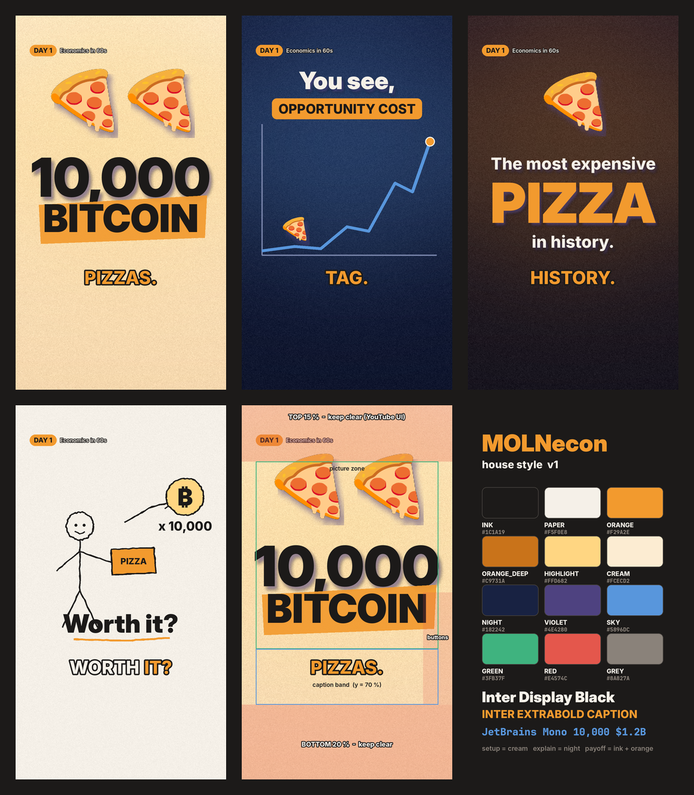
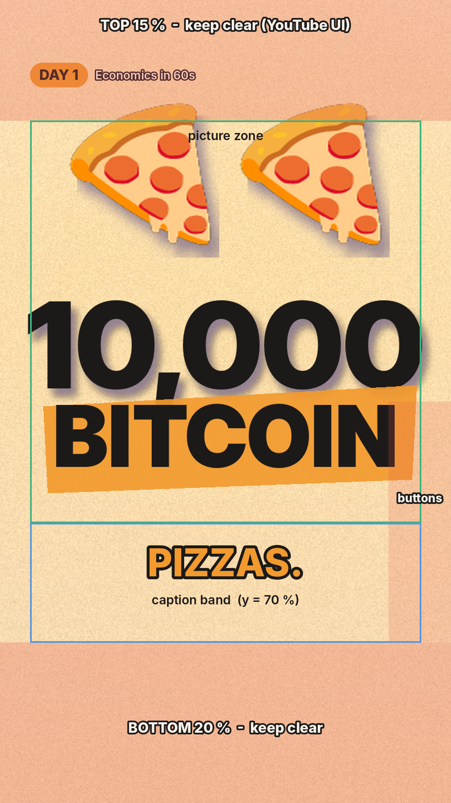

# MOLNecon house style v1

The look of every MOLNecon short. Values live in code in
[`style/molnstyle.py`](style/molnstyle.py); this page explains them. Change a value there, not
here only. Sample stills: [`style/frames/`](style/frames/) (rebuild with
`python3 MOLNecon/style/make_style_frames.py --motion`).

## 1. Identity in one line

**Bold, warm explainer:** big black-ink words on a warm cream page, one orange marker swipe per
idea, emoji/icons as props, and the whole picture turns night-blue when "You see," starts the
explanation. Never still: a slow push-in all the time.

## 2. Colour (no pure black, no pure white)

| Token | Hex | Use |
|---|---|---|
| INK | `#1C1A19` | text, outlines, the darkest anything gets |
| PAPER | `#F5F0E8` | light text on dark, hand-drawn page, flash |
| ORANGE | `#F29A2E` | **brand**: marker swipe, current caption word, the key number |
| ORANGE_DEEP | `#C9731A` | orange in shadow |
| HIGHLIGHT | `#FFD682` | warm key light, coins, glow on setup |
| CREAM | `#FCECD2` | setup background (top) |
| NIGHT | `#182242` → `#0F152C` | explanation background |
| VIOLET | `#4E4280` | every cast shadow (cool, never brown or grey) |
| SKY | `#5896DC` | charts, cool accent |
| GREEN / RED | `#3FB37F` / `#E4574C` | gain / loss only |
| GREY | `#8A827A` | secondary text |

Rule: max **one** orange element besides the caption at any moment. If everything is orange,
nothing is.

## 3. Light follows the story (3 moods)

| Mood | When | Background | Text | Glow |
|---|---|---|---|---|
| `setup` | hook → escalation → mystery | cream → peach gradient | INK | warm HIGHLIGHT |
| `explain` | from "You see," to the analogy's end | NIGHT gradient | PAPER | SKY |
| `payoff` | last 1-2 lines | deep plum-ink | PAPER, keyword ORANGE | ORANGE |

Every background has a soft radial glow at 36 % height and fine paper grain (±5 levels) so
flats never band. Switch moods with a 7-frame crossfade; the hook ends with a 4-frame PAPER
flash.

## 4. Type

| Role | Font | Size (px @1080 wide) |
|---|---|---|
| Hero number | Inter Display Black | 210 (max ~6 characters per line) |
| Keyword | Inter Display Black, on an orange marker swipe | 150 |
| Headline ("You see,") | Inter Display Black | 110 |
| Caption | Inter ExtraBold, PAPER, 7 px INK outline | 92 |
| Label / pill | Inter ExtraBold | 60 |
| Counters, prices, data | JetBrains Mono ExtraBold | as needed |

Big words carry a cast shadow: VIOLET, offset (+10, +14), blur 6, like a real key light from the
top-left.

## 5. Layout (1080 × 1920)

- **Top 0-288 px (15 %):** YouTube UI. Only the Day badge lives here (top-left, y = 150).
- **Picture zone 288-1250 px:** all illustration, numbers, keywords.
- **Caption band 1250-1536 px:** captions only, centred at y = 1344 (70 %).
- **Bottom 1536-1920 px (20 %):** keep empty. Right 150 px of the lower half: buttons, keep clear.
- Side margins 72 px.

**Day badge:** orange pill "DAY N" + "Economics in 60s", for the whole video.

**Captions:** 1 word (max 3), hard swap on each word, synced to `words.json`, landing 0-2 frames
before the spoken word. Current word ORANGE, others PAPER.

## 6. Motion (frame numbers at 30 fps)

| Thing | Value |
|---|---|
| Hold creep (push-in) | +0.25 %/frame zoom, never 0; +0.6 %/frame on punch words |
| Moves / glides | smootherstep, 24 frames (18-40). Never under 18 frames |
| Pop-in (icons, numbers) | back-out overshoot, 8 frames |
| Marker swipe | wipes left→right over 10 frames under its word |
| Impact | shake 18 px, sign flips every frame, decays over 7 frames |
| Crossfade | 7 frames, only when place, time or mood changes |
| Flash | 4 frames PAPER, once, right after the hook |
| Hard cuts | 0-1 per video |
| Frozen frames | 0 spans ≥ 12 frames (QA measures it) |

Charts and lines **draw themselves** (≈ 40 frames) rather than appearing.

## 7. The three picture styles (rotate daily)

- **A: Bold text + icons** (default; shown above). Moods, marker swipe, emoji props, charts.
- **B: Hand-drawn.** PAPER page with grain, INK felt-pen lines (double jittered pass, 7 px),
  simple stick figures, ONE orange accent fill per frame, HIGHLIGHT for coins/money. In the
  explanation, wash the page with NIGHT at 85 % and switch lines to PAPER.
- **C: 2D flat characters in a 3D world** (three.js + Remotion, template from
  mromidev/claude-animated-shorts). Runs on Nursultan's PC. Targets from the measured study:
  ink lines on ~72 % of edges, 23-frame slow-in/slow-out camera, camera moving in ~65 % of
  frames, no pure black, purple (not brown) sunset shadows, bodies 3.5 heads tall with thin
  limbs, round heads, blurred backgrounds. Our palette tokens above still apply; the Day badge
  and captions are identical in all three styles.

## 8. Sound identity

- Voice: Kokoro `am_michael`, 3.5-4 words/s, total gaps < 1 s.
- Music bed 5-10 dB under the voice, ducked; original or licensed only.
- SFX kit (same sounds every day so the channel has a "sound"): **whoosh** on glides,
  **pop** on icon pop-ins, **coin** on money numbers, **thud** on impacts, **soft riser** into
  "You see,".
- Master: -14 LUFS integrated, true peak -1.5 dB.

## 9. Do / don't

- Do show every sentence literally; the prop carries the joke.
- Do open on the most surprising number or picture. No logo, no title card.
- Don't use pure #000 / #FFF, brown or grey shadows, 3-frame snaps, or static holds.
- Don't put anything important in the top 15 %, bottom 20 %, or the right button column.
- Don't use trending songs or someone else's characters.
