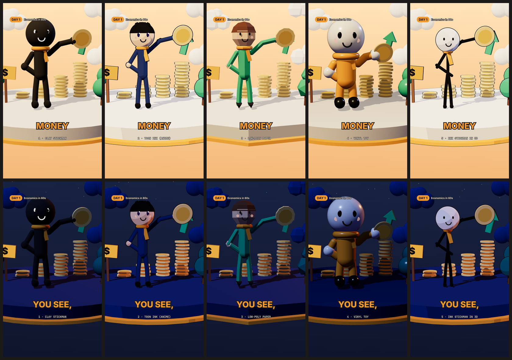

# MOLNecon 3D style kit (three.js)

Mascot **Moln**: the channel's recurring character. Signature in every look: **orange scarf**,
holds a **gold coin**, stands on the floating **MOLNecon island** (cream top, orange rim) with a
coin-stack bar chart behind him. Lighting follows the story (`mood=setup` warm, `mood=explain`
night-blue).



| # | `style=` | Look |
|---|---|---|
| 1 | `clay` | 3D clay stickman: matte, soft, dark body, white eyes |
| 2 | `toon` | Toon ink / anime: cel shading + black ink outlines (closest to the reference channel) |
| 3 | `lowpoly` | Low-poly papercraft: faceted, flat-shaded diorama |
| 4 | `vinyl` | Vinyl toy: glossy clearcoat, chibi proportions, orange body |
| 5 | `stick` | Ink stickman standing in a toon 3D world |

Render stills (1080x1920, ~1 s each, works on the cloud machine with SwiftShader):

```bash
cd MOLNecon/style3d && npm install && node render.js            # all styles, setup mood
SHOTS='[{"style":"toon","mood":"explain","cap":"YOU SEE,"}]' node render.js
```

URL params of `scene.html`: `style`, `mood` (`setup` | `explain`), `cap` (caption word),
`kw` (keyword over the scene), `label=0` hides the style label.
